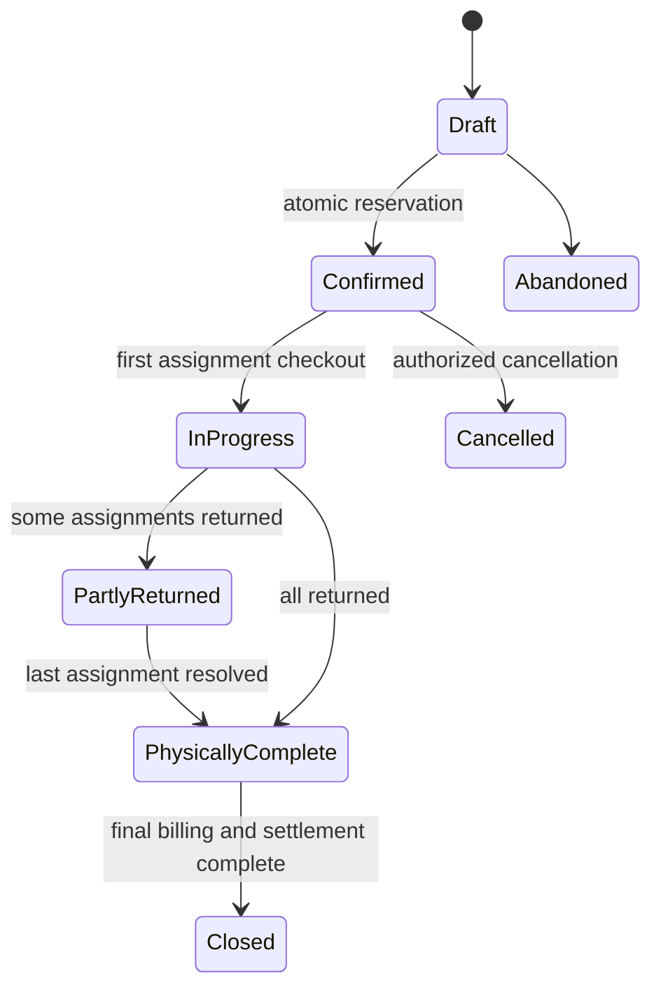
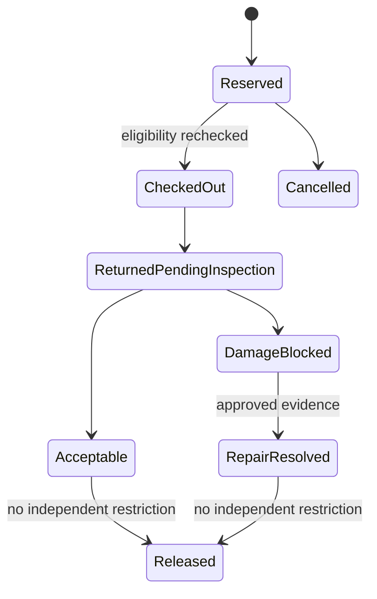
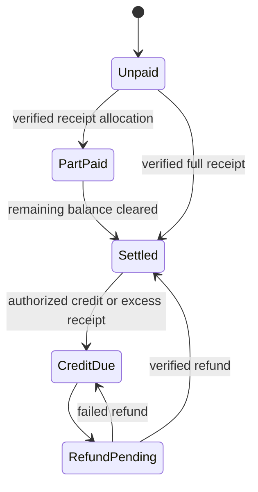
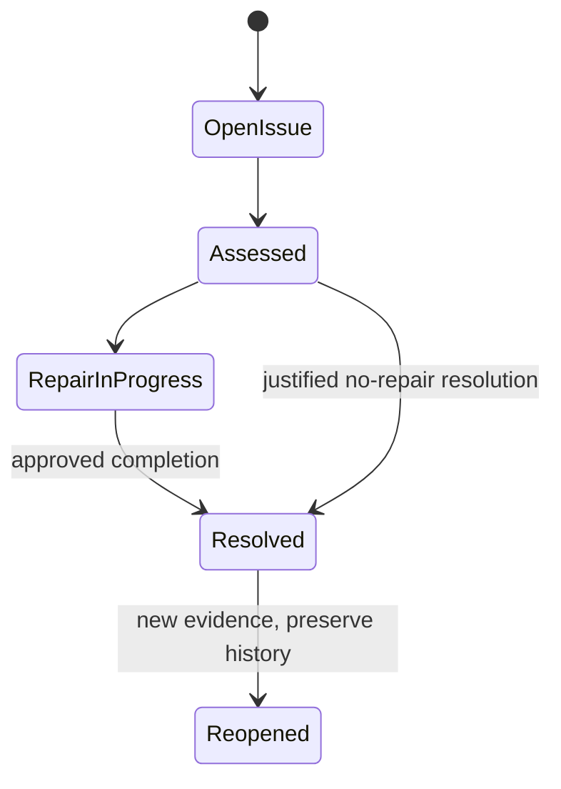
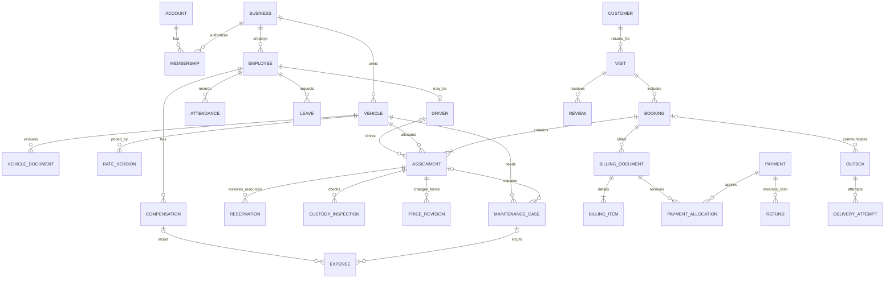

# Smart VRMS — consolidated planning baseline v0.4

Prepared: **25 October 2026, Asia/Kolkata**. Research checked: **24–25 October 2026**; provider-price table checks are dated individually below.
Status: **DRAFT FOR REVIEW**. Planning artifacts only. Nothing in this file represents implemented or verified application behavior.

## 1. Purpose, scope, and interpretation

Build a native desktop operating system for one Kerala vehicle-rental company. Administrator and Employee users coordinate customers, repeat visits, fleet and drivers, single/package bookings, checkout, extensions, returns, inspections, balances, documents, maintenance, personnel records, expenses, reports, and communications. The final delivery goal includes real downloadable packages for defined Windows, macOS, and Linux targets.

**CONFIRMED REQUIREMENT:** Java application code with a Java 17-compatible source baseline; Swing; MVC with separate services and integration/persistence; Maven; Supabase/PostgreSQL; Git; explicit dependency approval. No Spring Boot, Jakarta EE application framework, Hibernate, browser frontend, JavaFX, JavaScript/TypeScript service, or Edge Function is proposed. SQL is reserved for migrations, constraints, indexes, RLS, and approved transactional/access operations.

**CONFIRMED REQUIREMENT:** all original discovery features remain mandatory. The accompanying CSV expands them into individual requirements. Phases define delivery order, not optionality. Prior VRMS material is a reference only; its implementation has not been accessed or verified.

**CONFIRMED DECISIONS:** India/Kerala; one company; internal staff accounts with administrator invitations; records and expenses rather than calculated statutory payroll; vehicle release after acceptable inspection even with an unpaid balance; staff-recorded reviews; optional refundable deposit treatment and disclosed cancellation/late-return terms; daily three-day document checks at 09:00 Asia/Kolkata with one threshold email and one expiry email to administrators and responsible active employees; zero recurring beta services and merchant UPI/manual verification.

**WORKING ASSUMPTION:** INR; Asia/Kolkata for business periods; English interface with Unicode names and Malayalam-capable fonts/data handling; one operating location initially; internet required; no offline transaction mode. Multi-company isolation remains an architectural defense, not a new multi-company product requirement. Translation and multi-branch operation are OPTIONAL ENHANCEMENTS unless separately approved.

**PROPOSED SOLUTION:** recommendations below form a concrete review baseline. “Recommend for me” authorizes a recommendation, not a fictional tax registration, an approved commercial policy, a provider account, or a billing commitment.

## 2. Product outcomes and scope boundaries

Staff must complete a booking without re-entering an existing customer, see truthful exact-period availability, and explain every charge. Concurrent staff must not allocate the same resource twice. Administrators must distinguish money received from revenue, deposits, receivables, and expenses. Returned assets must reflect real physical condition while debts remain visible. Histories survive deactivation, price changes, document renewal, refunds, and repairs. Customer/service detail includes the required review-entry box and review history under the approved staff-recorded feedback method.

No customer or driver account is required. Staff record customer feedback received by phone, email, or in person. No automatic blacklisting or AI feature is proposed. No statutory payroll, accounting filing, payment-card storage, offline synchronization, automatic desktop update installation, or universal OS support is claimed. These boundaries do not remove mandatory operational finance, salary tracking, QR/payment requests, PDFs, emails, or cross-platform distribution.

Success is demonstrated by the five connected journeys in section 8, the CSV acceptance criteria, real Supabase permission/concurrency checks, reliable failure recovery, visual review, and installation evidence on each supported target. “No known blocking defects after the agreed checks” is the permitted readiness claim.

## 3. Decision register and gates

| ID | State | Decision or recommendation | Gate/impact |
|---|---|---|---|
| DEC-001 | CONFIRMED | India/Kerala, one company | Jurisdiction and ownership |
| DEC-002 | WORKING ASSUMPTION | INR and Asia/Kolkata | Confirm with final baseline |
| DEC-003 | CONFIRMED | Staff accounts only; administrator invites Employee accounts | Authentication design |
| DEC-004 | CONFIRMED | Employee may record operational payments; refunds, financial corrections and exceptional discounts need Administrator | Exact matrix below recommended for approval |
| DEC-005 | CONFIRMED | Return/inspection may release vehicle despite debt | Debt retained; closure distinction below |
| DEC-006 | CONFIRMED | Attendance/compensation records and expenses; no statutory payroll calculation | No invented deductions/leave pay |
| DEC-007 | CONFIRMED | Deposits refundable/separate; charges/refunds follow pre-disclosed terms | Amounts and terms must be configured |
| DEC-008 | CONFIRMED | Daily 09:00 IST document scan; one <72h reminder and one expiry message; responsible staff | Free scheduler best-effort requires monitored lag |
| DEC-009 | CONFIRMED | Staff-recorded feedback with history | No public review frontend |
| DEC-010 | CONFIRMED | Zero recurring beta cost; direct merchant UPI/manual confirmation | Previous gateway selection is refined to this beta method; QR remains mandatory |
| DEC-011 | PROPOSED SOLUTION | 24h duration, first-day minimum and hourly remainder; 30-minute return grace; rules in section 4 | Explicit commercial-policy approval before implementation |
| DEC-012 | PROPOSED SOLUTION | Age recorded per visit with as-of date; no DOB required | Self-drive eligibility uses actual licence checks, not reported age alone |
| DEC-013 | DECISION REQUIRED | Actual GST registration/category and accountant-confirmed treatment cannot be inferred | Blocks real tax invoicing; prototype remains visibly unverified/demo |
| DEC-014 | PROPOSED SOLUTION | Separate custody, allocation, debt, closure; close only after all assignments resolved and financial settlement complete | Preserve original closure condition; no withholding asset availability solely for debt |
| DEC-015 | PROPOSED SOLUTION | Java API with server JDBC transactions, private database schema, Auth/Storage HTTP | Final architecture approval needed |
| DEC-016 | PROPOSED SOLUTION | Maven contracts, application, desktop, server modules; worker shares application services | No files/modules created yet |
| DEC-017 | DECISION REQUIRED | Free-tier provider accounts, email sender identity/domain and hosted worker schedule | All providers unselected; no account or DNS changes |
| DEC-018 | PROPOSED SOLUTION | Support targets in section 16 | User approval and actual device evidence required |
| DEC-019 | DECISION REQUIRED | Signing/notarization resources compatible with zero recurring budget | Full trusted public macOS release remains blocked without existing membership, eligible waiver, sponsor, or approved budget change |
| DEC-020 | DECISION REQUIRED | Library/version approvals in section 13 | No dependency introduced by this plan |
| DEC-021 | PROPOSED SOLUTION | Manual attendance; historical salary arrangements and actual approved payments; driver compensation fixed/trip/time/mixed records | Pay amounts/terms entered by Administrator, no automated payroll math |
| DEC-022 | PROPOSED SOLUTION | Standard employee invoice finalization, no employee price/tax override or discounts until an explicit threshold is approved | Matrix approval |
| DEC-023 | PROPOSED SOLUTION | Monday week, calendar months, April–March financial year; operating accrual margin plus separate cash report | Reporting policy approval; not tax filing |
| DEC-024 | PROPOSED SOLUTION | DD/MM/YY compact display plus full-year detail/accessible label; editable dates and PDFs use DD/MM/YYYY | Explicit date-display refinement approval |
| DEC-025 | PROPOSED SOLUTION | Bounded photo/document size, private metadata, no persistent desktop session by default | File retention and runtime review at security gate |

Approval gates: G0 final requirements/policies/architecture plan; G1 dependency/tool/provider prerequisites and representative rendered Swing UI; G2 database/security integration; G3 atomic booking/pricing; G4 return/finance correctness; G5 end-to-end automation/recovery; G6 each platform; G7 explicit deployment/publication authorization. Account configuration is not needed merely to review this plan. The separate development/release prompt is retained as the execution procedure after G0.

## 4. Recommended business rules

### Time, dates, pricing and commercial terms

**BR-BOOK-001 — intervals:** use exact start/end timestamps and half-open intervals [start,end). Adjacent reservations can meet at the boundary, but a vehicle must also have completed required inspection/preparation. Record an explicit preparation buffer per vehicle/category, proposed default zero until the company sets one. Never claim an unknown buffer is operationally adequate. Start must precede end; no backdated checkout without Administrator correction workflow.

**BR-BOOK-002 — guided vehicle-first selection:** customer/visit, single/package choice and provisional fleet shortlist come first. Until start/end are supplied, label availability “Choose dates to check”. Then show exact eligible physical vehicles and suitable drivers. The final review revalidates everything. Category/model/capacity filters narrow choices but do not prove availability.

**BR-PRICE-001 — proposed complete beta rule:** each assignment uses a versioned per-24h vehicle rate R selected from an Administrator-maintained rate plan; no capacity multiplier. For planned positive duration D, up to 24h costs R. Above 24h, completed 24h blocks cost R each; any remaining period is rounded up to whole hours, charged at R/24 per hour, capped at R for that remainder. No intermediate currency rounding: calculate decimal/rational amounts with adequate precision, then round each posted money line to INR 0.01 with HALF_UP. Sum rounded lines. This provides a simple first-day minimum while avoiding an automatic full second day for a small extra planned interval. All quoted duration/rounding terms are shown before confirmation.

**BR-PRICE-002 — extensions:** reprice the assignment's entire planned duration under its saved rate version and post only the delta from the previous approved total. Do not apply a second first-day minimum. Preserve each revision and employee confirmation. Driver charges use a separately selected, disclosed daily/trip/hourly customer charge basis; these charges do not determine employee compensation expense.

**BR-PRICE-003 — proposed late rule:** actual return after agreed end is operationally overdue immediately. Proposed financial grace is 30 minutes once at final return, not per day. Charge elapsed late time beyond grace rounded up to whole hours at the saved daily rate/24, with each additional 24h capped at the saved daily rate. No punitive multiplier. Example: 70 minutes late means 40 chargeable minutes, rounded to one hour. A requested extension uses the extension quote, not both extension and late charges for the same interval. Changes to grace/rounding require approved versioned terms.

**BR-PRICE-004 — early return/cancellation/deposits:** early return does not automatically discount the contracted charge; Administrator can approve a documented credit. Proposed beta cancellation penalty is zero unless a disclosed, specifically approved cancellation schedule or nonrefundable incurred extra applies. Record reason and affected assignments, cancel future allocation atomically, and process any refund separately. Optional deposit defaults to zero until configured; it is a refundable liability, not advance revenue. Deposit application to an approved customer charge is an explicit ledger transfer, not a duplicate payment. No retention for ordinary wear without responsibility/evidence/approval.

**BR-TAX-001:** actual company registration is unknown. Support tax configuration states UNVERIFIED, verified nonregistered, verified registered, and other accountant-approved treatments. UNVERIFIED cannot issue real documents claiming GST registration, zero-rating, exemption, or tax collection. Fictional examples/documents must say DEMO / NOT FOR TAX USE. A manual tax field is not a legal substitute for knowing registration/classification. Approved rates, tax components, GSTIN where applicable, SAC/classification, place-of-supply treatment, rounding and invoice/advance-voucher timing are verified with the company's accountant and saved in immutable snapshots. Never select a blanket rate from the vehicle category alone. [CBIC rates](https://cbic-gst.gov.in/hindi/gst-goods-services-rates.html), [CGST tax invoice provisions](https://taxinformation.cbic.gov.in/content-page/explore-act/1000300/1000001/invoice/ACTS), [invoice particulars](https://cbic-gst.gov.in/gst-invoice-rules.html).

**BR-CUST-001:** recommended age is an integer recorded with each visit's as-of date and source, not a permanently current age on Customer. Show “Age 32, recorded 24/10/2026”. DOB is not collected merely to calculate this field. Licence age/class/identity verification for self-drive operation remains separately required where applicable. Customer, Visit, Booking, Assignment, Invoice and Payment each have distinct identities. Visit captures reason and visited-at date/time. Reuse identity without overwriting previous contact/document snapshots.

### Release, personnel and documents

**BR-RETURN-001:** acceptable inspection releases that assignment's vehicle when there is no other restriction or custody conflict, regardless of debt. An outstanding balance remains on customer/visit and receivable lists. Final service closure is proposed only after all assignments are returned/cancelled, inspections and final billing are resolved, and customer settlement is complete. No review is required. Damage opens a block before custody is released. Other unaffected vehicles may be released. Driver duty release is independent of repair, with later assignments/leave/licence restrictions still evaluated.

**BR-ALLOC-001:** reservations, physical custody, and restrictions are separate facts. Overdue custody can overlap the time of a later contractual reservation; record this real operational conflict and block the later checkout, without refusing the actual return, rewriting history, or silently cancelling a confirmed booking. Reassignment requires staff authorization and preserved contractual history. Validity for the requested full period is checked at confirmation/extension and again at checkout; renewal does not retroactively edit past checks.

**BR-STAFF-001:** Administrator records present/absent/partial-day/leave attendance with date, duration where relevant, source and correction reason. Leave is a dated interval with approval state. Approved driver leave blocks new assignment; adding leave against an existing booking creates a resolution task. Store historical salary/compensation agreements, entered approved accruals and actual payments. Do not calculate legal leave-pay, overtime, PF/ESI or other deductions. Fixed pay and trip extras have distinct expense sources so neither is duplicated.

**BR-DOC-001:** for a date-only document, proposed validity lasts through the issuer's stated expiry day in the applicable issuer/business zone; normalize to exclusive next-day midnight. An explicit issuer timestamp overrides this convention. At the approved daily scan, remind only when 0 < expiry-now < 72h, strictly excluding exactly 72h; send a separate expiry event when expiry <= now. A date-only document valid through 27/10/2026 has proposed exclusive expiry 28/10/2026 00:00 IST; the 25/10 09:00 scan finds 63h remaining. A timestamp of 27/10 09:00 has exactly 72h remaining at 24/10 09:00 and is not yet in the strict window. These examples make the boundary reviewable rather than implying all documents have identical expiry semantics.

**BR-DOC-002:** one threshold email and one expiry email per document version and eligible recipient; no daily repeat. Catch up after a missed scan or outage: send the applicable current event, not stale threshold emails for already expired versions. Resolve recipients at send time against active accounts and responsibility assignments; preserve resolution history. An administrator is always a recipient when a valid address exists. Missing recipients and email quota failures appear in the administrator queue. Renewal supersedes unsent old jobs, preserves old sent history, and is rechecked before sending.

## 5. Role and permission matrix — proposed exact split

All actions require active business membership and account status. Administrator includes Employee operations. “Standard” means saved rates/taxes and approved workflow, no override. Deactivation preserves history. Denial must occur in API/database access, including exports and file URLs.

| Capability | Employee | Administrator |
|---|---|---|
| Fleet gallery, profiles, period availability, operational documents | View | View |
| Vehicles/categories/rate plans; deactivate vehicle | No | Create/update/deactivate |
| Freeze/reactivate vehicle | Record operational freeze with reason; reactivate only after all restrictions clear | Same plus configuration/override workflow; never unsafe bypass |
| Document renewal and reminders | Record renewal for assigned fleet responsibility | All; assign responsibility/recipients |
| Driver operational name/contact/licence/availability | View; record incident/unavailability request | Maintain/deactivate; approve leave/unavailability |
| Customer | Search/view/update operational details; create only in booking | Same; authorized identity merge/correction |
| Customer documents | Minimum needed for the rental; authorized single-document download | Same plus justified administrative access; no unrestricted public files |
| Booking, driver assignment, checkout, acceptable return | Create/update through standard workflows | Same |
| Extension | Confirm within saved rates and resource eligibility | Same; authorized price adjustment |
| Cancellation | Before checkout under standard zero-charge terms; no refunds | Complex/partial/financial cancellations and refunds |
| Quote/booking document/draft invoice | Prepare/view/download | Same |
| Finalize routine invoice | Yes if tax setup verified, standard prices and required checks pass | Yes; configuration and approved corrections |
| Payment recording | Verified cash/bank/UPI record with amount/reference/source | Same; reconcile and correct by reversal |
| Discounts | None until a nonzero threshold is explicitly approved | Reason required; saved in pricing revision |
| Refunds, credit notes, financial corrections | Request/view permitted customer settlement outcome | Approve/post/reconcile; no deletion of history |
| Damage/inspection/maintenance observations | Create/update evidence and operational status | Same; approve actual costs, responsibility and recovery |
| Maintenance close/reactivation | Request/record completion evidence; eligibility checks still apply | Approve resolution; all independent blocks checked |
| Staff profiles, salary/compensation, attendance/leave calendar | No personnel administration or payroll access | Create/view/update/deactivate; historical records retained |
| Expenses and company operating margin | No | Create/approve/pay/report/export |
| Operational rental balance lists/PDFs | View authorized operational data | Same |
| Bulk exports/profit/payroll reports | No | Permissioned export; sensitive column allowlist |
| Review | Record source/comment/date; correction adds version | Same; moderation reason/history |
| Notification status/resend | Booking-specific status/request resend | Global failures, controlled resend, reminders |
| Audit | Limited history for relevant operational records | Business-wide view/export; no alteration |
| Settings, staff invites, account revocation | No | Yes; last active Administrator protection |

No other role is introduced. Permission names may distinguish actions within these two roles without creating Manager/Cashier workspaces.

## 6. Authoritative workflows and exceptions

### WF-BOOK — book a single vehicle or package

1. Authenticate active staff. Search customer by ID/name/contact, show duplicate suggestions without auto-merging. Capture new customer only in this workflow and gather current visit reason/date and age-as-of.
2. Select single/package and provisional vehicle shortlist; dates not supplied means availability unknown. Enter exact pickup/return, requirements and per-assignment driver need. Show suitable physical vehicles, driver licence/leave conflicts and document validity.
3. Services calculate saved-rate prices, driver charges, optional deposit, approved extras/discounts and verified tax treatment. Show each assignment plus consolidated total, document type, money actually received and due. A payment arrangement is not proof of received funds.
4. Review creates a stable idempotency key. Server verifies token and membership, locks resources in stable ID order, rechecks constraints/restrictions, creates Customer/Visit where new, Booking, Assignments, ReservedWindows, pricing revision, approved payment records and outbox intent in one PostgreSQL transaction. Confirmation is all-or-nothing. A mere shortlist never holds inventory.
5. Commit returns identifiers and confirmed snapshot. PDF generation and customer email follow durable work. The UI shows confirmed booking even if PDF/email is queued or failed. No success message before commit.

Failures: unavailable member rolls back the full package; identify conflicts and let staff choose again. No duplicate Customer/Visit from a retry. If the response is lost after commit, retrieve the stored result using the same key; conflicting key payload returns conflict. Unsaved draft state is not a reservation. Server validation errors map to fields; authorization errors do not reveal other customer/financial details. A duplicate customer creation race suggests a review task rather than forcing identity equality on phone/email.

### WF-OUT — checkout and running services

Recheck vehicle/driver eligibility, valid documents, current custody and unresolved booking conflicts; record actual pickup, condition, evidence, odometer/fuel where approved, and staff. Set custody/duty independently for every assignment. Prevent duplicate checkout. Package dashboard aggregates assignment states rather than overwriting them with one status. Missing payment may be permitted only under disclosed advance policy; no invented mandatory advance percentage. Propose zero minimum advance until Administrator configures one.

### WF-EXT — extend

Select all or specified assignments and revised ends. Recheck the full extension interval against other reservations, maintenance, freezes, licences/leave and document validity. Present incremental cost and previous payments. Staff confirms; transaction locks the relevant resources and booking version, updates only successful approved scope, records revision and outbox intent. If the selected scope cannot all extend, commit none of that extension; original booking remains valid. A requested partial package extension is explicit, not accidental partial confirmation.

### WF-RETURN — physical return, inspection and settlement

Record actual return even if overdue or unpaid. Each assignment has a unique custody close operation. Inspection marks acceptable, damaged, pending inspection, or unavailable. Pending inspection prevents release. In the same transaction create blocking damage/maintenance work when needed, close custody, record condition/evidence and change eligibility. Driver duty ends independently. Show remaining package assignments and later bookings at risk. Calculate final charges using approved revisions, record debt or final payment, finalize correct documents, and mark settlement separately. An unknown inspection result is not “acceptable”. Close the service only under approved closure rule. Request an optional review after return and final payment, once per service.

### WF-DAMAGE — repair and recovery

Classify customer-caused damage, ordinary wear, scheduled service or emergency breakdown; record estimated versus actual cost and evidence. Administrator approves responsibility and any customer recovery separately. New downtime affecting future bookings creates visible affected-service tasks; staff may propose substitutions but must preserve original assignments and authorization. Expense recognition and actual repair payment are separate linked records. Resolution closes only that restriction; release recomputes every remaining block. A closed damage record cannot bypass an expired document or another open issue.

### WF-PAY — direct UPI/cash/bank and corrections

Create a PaymentRequest tied to invoice/booking, INR amount, internal request ID, expected purpose (advance, rental, deposit), due/expiry, and verified merchant destination. Beta may embed an administrator-verified bank/acquirer QR image. Static merchant QR cannot enforce a request's amount, expiry or booking identity; the app's expiry is an operational request state, not a bank-level cancellation. Show amount/reference separately and reconcile late, partial, excess or unmatched credits. UPI intent/deep link is enabled only from a bank-approved format; do not invent a gateway response.

Employee checks business bank/provider records, not a customer screenshot/claim, then records received amount, channel, bank reference and evidence/verification source. No API automatically marks QR displayed/opened as paid. Cash records identify receiving employee and receipt. Duplicate bank reference/amount/date checks prompt reconciliation; external transfer identity is unique where the bank supplies one. Shared/reused reference text alone is a suggestion, not universal proof of duplication. Unmatched funds stay unapplied until authorized allocation. Allocation cannot exceed the verified payment without authorized correction. Refunds are separately authorized cash outflow linked to credit/deposit/payment; mark pending until bank evidence confirms. Do not automatically issue a second refund on timeout.

Future gateway adapters must verify signatures with server-only secrets, match provider order/request, amount and currency, store unique provider event IDs, reconcile by API after lost callbacks, and tolerate out-of-order notifications. This is a deferred integration proposal, not a silent replacement for required beta QR/manual verification.

### WF-MSG — durable email/reminder work

Transactionally store the business event and outbox intent; a Java worker claims jobs with leases, attempts delivery outside the database transaction, and records outcome. Stable delivery idempotency key and provider support reduce retry duplicates. There is no absolute exactly-once guarantee across an external provider: an accepted email with a lost response may need reconciliation before resend. Distinguish queued, processing, provider-accepted, delivered-if-confirmed, failed, superseded and unknown outcome. “Sent” means accepted by the provider, not read by the recipient. Bounces/complaints become visible. Attach the approved customer PDF only, with no identity documents/payroll/company margin; sending an attachment creates a recipient copy that cannot be revoked. If links are used, customer access must use short-lived scoped tokens, not staff login or public bucket URLs.

Reminder scan follows BR-DOC-001/002. Scheduled work runs on a hosted execution service independently of all desktop machines. Free beta delays are visible as last-success time, overdue scan indicator and outbox age; no claim of on-time delivery during provider downtime. Manual catch-up is available to Administrator.

## 7. Separate lifecycle diagrams

These states are derived or transactionally transitioned under service rules; they are not one combined status column.

Vehicle availability is a query over ReservedWindow, open Custody, operational restrictions and document validity for the requested period. It is not the assignment state above. Driver availability separately combines booked/duty interval, licence eligibility, leave and operational restrictions; no salary/employment flag implies availability.

Invoice: Draft -> Finalized -> Credited/PartlyCredited through separate documents; never overwrite Finalized. PaymentRequest: Open -> PartPaid/Paid/Expired/Cancelled, with late/unmatched receipts handled separately. Payment: RecordedUnverified -> Verified -> Allocated; reversal is a new entry. Staff employment: Active/OnLeave/Inactive with account Enabled/Revoked independently. Document: Current/Superseded, with due/expired derived from validity. Notification follows WF-MSG and does not change booking validity.

## 8. Connected acceptance journeys and examples

All names/rates below are fictional, illustrative proposals. **No GST rate or real company registration is implied.**

**A — first visit:** Anu gets Customer C-000123, Visit V-000451, Booking B-000700 and Assignment A-001. Car R=INR 2,400/day, 10/11/2026 10:00 to 12/11 10:00: base 4,800. Verified advance 1,000 leaves provisional rental balance 3,800. Extension to 13/11 10:00 changes base to 7,200; delta is 2,400, not a second booking or duplicate advance. Acceptable return releases the car. Final payment 6,200 settles the 7,200 rental. Correct final PDF and receipt are queued by version; provider failure remains visible. Staff records voluntary feedback after settlement. If a separate deposit of 3,000 was received, rental collected is still 7,200 and deposit held is 3,000 until refunded/applied; total gross cash receipts before deposit refund is 10,200.

**B — repeat/package:** Anu reuses C-000123, gets a new Visit V-000452 and new Booking. For two days, Car at 2,400/day = 4,800, Scooter at 600/day = 1,200, Car driver customer charge at 800/day = 1,600, total before applicable verified tax = 7,600. Scooter needs no driver. Car and Scooter physical IDs are distinct; package confirmation commits both and the driver together or neither. Customer driver charge of 1,600 is not assumed to equal driver compensation expense. Return Scooter early: preserve contracted charge unless an authorized credit is approved; Car remains in service. Consolidated billing retains assignment-level lines.

**C — damage:** Car returns damaged, custody ends and repair restriction opens. Customer owes 2,000 rental balance; car stays blocked regardless of payment. Estimate 4,000, approved actual repair 3,500; repair expense recognized once on the selected basis, actual payment linked separately. Evidence supports an approved customer recovery of 1,500, which is a separate charge/receivable, not a negative repair expense. Paying the repair creates no second expense. Resolution does not release the vehicle if insurance is expired or another freeze remains.

**D — leave/pay:** Employee/driver D-002 has approved leave overlapping a requested assignment; allocation is denied with a useful alternative. Attendance is manually recorded and corrected with reason. Administrator records fixed compensation expense of 20,000 for the month and an independently approved trip extra of 1,000 if terms allow. Payment of 21,000 clears the compensation payable; the same 21,000 is not added again to accrual expense. No legal deductions or automatic leave-pay calculation is invented.

**E — document reminder:** a date-only insurance version valid through 27/10/2026 has proposed exclusive expiry at 28/10 00:00 IST. At 25/10 09:00, remaining validity is 63h; create one due notification per responsible active recipient. Renewal on 26/10 saves a new version/validity, supersedes pending old notices and retains old delivery history. If no renewal, create one expiry notice on the next applicable scan; no repeat spam. Scheduler outage records a missed target and catch-up, never a fabricated successful send.

**Finance examples:** five hours planned costs the proposed first-day minimum of 2,400. Twenty-six hours costs 2,400 + 2*(2,400/24) = 2,600. Two confirmed days extended to three costs a 2,400 delta. A 10% Administrator-approved discount on a 2,600 rental line yields 2,340 before verified tax; this example is not a default allowed discount. A 2,400/day assignment returned 70 minutes late adds one proposed chargeable hour = 100, subject to approved disclosed terms. Taxes are a symbolic separately rounded T until verified; payable rental is net charges + T, not a guessed GST percentage.

**BR-FIN-001 — reporting:** proposed operational accrual view recognizes earned rental charges against completed/performed assignment periods, net approved credits; future-service advances remain liabilities until earned. Invoice issue date is not automatically revenue recognition date. Track billed, earned and collected separately. Recognized tracked expenses use incurred/approved period, not payment date; expense payments reduce payable/cash only. Reports may show unearned billed amounts explicitly rather than silently recognizing them. Proposed week is Monday 00:00 to next Monday, month calendar-based, financial year 1 April–31 March, all in business timezone with exclusive end boundaries.

**BR-FIN-002:** “Rental operating margin” = earned tracked rental/service income plus separately labeled approved damage recoveries minus recognized tracked operating expenses, net credits and excluding tax/deposits. It is not complete statutory net profit; missing depreciation/finance/overhead costs are disclosed. Cash report separately shows receipts, refunds, expense payments and deposit inflow/outflow. A credit reduces revenue/receivable; its cash refund does not create a second expense. Bank/gateway fees, if approved later, are separate expense lines. Every posting has an immutable source identity preventing double recognition.

## 9. Conceptual data model and dictionary

This is conceptual, not executable schema. Technical keys proposed UUIDs; human IDs are company-scoped unique sequences such as C-000123, V-000451, B-000700, I-2026-00001. Human invoice sequence must follow verified document rules and not be recycled. Technical IDs are not permissions. Every business row has business_id where applicable, actor/time/version metadata, and immutable historical references. Amounts use PostgreSQL numeric/Java BigDecimal, currency explicit; instants use timestamptz and named business timezone; birth/visit/document dates use date where genuinely date-only. Avoid floats and timezone-free timestamps for custody.

| Concept | Required/core fields and relationships; optional fields explicitly noted | Integrity/privacy/history |
|---|---|---|
| Business/configuration | ID, legal/display name, address, timezone/currency, verified tax state, rate/terms versions, email/UPI public settings | One active company initially; no secret credentials in client configuration |
| Account/membership | Supabase auth UID, business, Administrator/Employee, enabled/revoked, optional employee link | Membership authority outside editable user metadata; staff employment separate; last Admin protected |
| Employee | Human ID, picture file reference, full name, contact, email, address, joining date, employment status | Salary required as compensation relationship, not a staff list field exposed to operators; duplicate suggestions not phone uniqueness |
| Driver/licence | Employee/person link, photo/contact/name, licence identifier/class, validity, experience value/as-of or start year, eligibility | Drivers may be employees or contracted personnel without login; avoid duplicate identity by linking person/employee rather than copying profiles |
| Attendance/leave | Employee, business date/interval, attendance state/duration, leave type and approval, source, actor, correction history | No calculated statutory entitlements; driver eligibility reads approved leave |
| Compensation/payment | Person, effective interval, fixed/time/trip/mixed arrangement, approved amount/basis, period/trip reference, payments | Administrator-only; sources unique to prevent salary/trip double expense |
| Vehicle/category | Physical vehicle ID, registration, category, picture, manufacturer/model/name, capacity, registration particulars, employment-independent operational state | Unique normalized plate within company, capacity positive, no deleting referenced fleet |
| RateVersion | Vehicle/model/category scope, basis, amounts, driver charge options, effective period, terms version | Specificity documented; old versions immutable; no capacity multiplier unless approved |
| VehicleDocument/version | Vehicle, type/jurisdiction/class applicability, identifier, issue/expiry/renewal dates, explicit validity semantics, private file, supersedes | Some types have no expiry; document authenticity manually checked; history retained |
| Resource/restriction | Vehicle/driver identity, period, type/reason, status, evidence, responsible staff | Freeze/maintenance/leave/doc restrictions may overlap existing bookings; create resolution tasks, never fail to record real safety blocks |
| Customer | Company-scoped ID, name, mobile/contact, email, address, optional identity file metadata when needed | Visit creation origin retained; phones/emails indexed but not inherently unique; no permanent active/returned flag |
| Visit | Customer, visit ID, visited-at, service reason, age + as-of, staff | Linked bookings/payment/review/document history; age belongs to historical context |
| Booking | Visit/customer, human ID, single/package, confirmation state, terms, idempotency identity, version | One booking has one or many assignments; cancellation/revision events preserve original |
| Assignment/reservation | Booking, distinct vehicle, optional driver, driver-required flag, planned range, rate/price references, active reserve range per resource | Partial package lifecycle supported; no duplicate physical vehicle in a package; booking resource windows constrained |
| Custody/duty/inspection | Assignment/resource, actual pickup/return, evidence, condition, inspection result/staff, optional odometer/fuel | One open vehicle custody; real overdue facts independent from planned reservation; inspection before release |
| Extension/price revision | Booking/assignment scope, original and proposed end, delta, previous version, staff approval, timestamp | Extension can be revision/event rather than gratuitous duplicate table; no overwrites of billed snapshots |
| Maintenance/damage/repair | Vehicle, optional assignment/customer context, type, issue/evidence, estimate, actual cost, responsibility/approved recovery, status | Repair expense and customer recovery separate; multiple unresolved cases allowed |
| BillingDocument/items | Quote/confirmation/invoice/receipt/statement/credit type, customer/vehicle/driver/rate/tax snapshots, totals, version, PDF file | Finalized records immutable; item assignment link for packages; documents have legal/type-specific number rules |
| PaymentRequest/payment | Internal request ID, booking/document, amount/currency/due/expiry, merchant destination version; receipt channel/date/ref/staff/source | Requests are not money; static QR expiry not bank-enforced; unverified records not counted as received |
| Allocation/deposit/refund | Payment-to-charge split, deposit liability movements, authorized credit/refund, cash verification references | Sum constraints prevent over-allocation; immutable corrections; deposit may be ledger subtype rather than separate table |
| Expense/payment | Category, amount/currency, incurred period, optional vehicle/booking/person/repair source, approved state, actual payments | Source uniqueness and payables prevent record+payment double-counting |
| Review/request | Visit/booking, request timing/state, optional rating and comments, source/date, consent/contact preference, correction versions | Review voluntary; no fabrication or automatic blacklist |
| FileMetadata | Object key, company/owner/type, MIME, size/hash, version, creation actor, retention/legal-hold state | Private buckets, randomized keys, restricted downloads; no public URL as ownership proof |
| Outbox/attempt | Event identity, recipient resolution, document version, state, lease, retry-after, idempotency key, sanitized provider outcome | Durable table, no passwords/tokens in payload/log; scoped worker access |
| AuditEvent/idempotency | Actor/system identity, action, target, time, request ID, safe before/after or change summary; request payload hash/result | Append-only for normal roles; no raw credentials; retention/admin access controlled |

Normalization: employee-driver identity may share a person record; rate and invoice snapshots are intentional history, not stale synchronized master data. Extension is a versioned business event if a separate entity adds no integrity value. Deposits are distinct financial movements even if implemented within one ledger. Dashboard flags, availability, balances, and profitability are derived from authoritative records, not independently editable copies.

Indexes: company+human ID unique; company+plate unique; customer name/normalized phone/email search; visit customer+date; reservation resource+range GiST; active custody resource unique; restrictions resource+period; document vehicle/type/expiry; billing customer/booking/date; payments external identity/date; expenses incurred period/category/vehicle; outbox next-attempt/status with partial index; audit target/time. Index RLS membership predicates. Exact indexes follow measured query plans; no benchmark claims.

## 10. Interconnection and transaction matrix

| Event | Atomic records/actions | Derived effects | Durable work / failure handling |
|---|---|---|---|
| Booking confirmed | Customer/Visit if new, booking, assignments, reserve windows, prices, verified receipt allocation if entered, audit, outbox | Fleet/driver calendar; customer visit/financial summary | Confirmation PDF/email; failure leaves committed booking visible |
| Checkout | Eligibility recheck, custody/duty, initial condition, audit | Running services; actual resource busy | No duplicate checkout; later reservation risk surfaced |
| Extension | Lock resources/version, conflict checks, planned window and price revision, audit/outbox | Revised running return/balance/calendar | Regenerate versioned confirmation; no duplicate minimum charge |
| Partial return | Per-assignment custody close, inspection, safety blocks, final charge lines, audit | Other package assignments stay active; released resources recalculated | Settlement/PDF tasks remain linked |
| Damaged return | Inspection + case + restriction before release, affected-booking tasks | Vehicle blocked; driver independently reevaluated | Admin resolution alert; no automatic customer charge |
| Repair approved/paid | Actual repair, one incurred expense source; separate expense payment | Expense/payable/cash report and vehicle margin | No expense counted again on payment |
| Receipt verified | Payment identity, allocation/deposit movements, receipt/audit | Balances and payment status | Receipt PDF/email, not a second booking |
| Refund approved/verified | Credit/deposit authorization and unique refund; separate cash confirmation | Liability/receivable/cash changes | Uncertain bank outcome stays pending; no blind retry |
| Staff leave | Approved interval, eligibility restriction, conflict tasks | Driver unavailable for overlapping dates | Existing confirmed trips require authorized resolution |
| Salary recorded/paid | Compensation source/expense then separate payment | Admin payroll-history/expense/cash views | Employee endpoints expose none of the private values |
| Document renewed | New file/version/validity, supersede pending old jobs, audit | Full-period eligibility recalculated | New threshold identity; prior delivery history retained |
| Review recorded | Visit/service feedback/source/history | Customer history | No dependency on service closure |
| Account revoked | Membership/account disabled, audit, outstanding-work task | API/file requests denied despite old access JWT | Client session expiry/re-login; no deletion of past actor |

## 11. Supabase security and transaction design

**PROPOSED SOLUTION — compare access models:** direct desktop-to-Data API can be secure only if every invariant and privilege is enforceable by RLS/constraints/RPC even when desktop code is bypassed. It lowers Java-server hosting cost but distributes business orchestration and pushes substantial pricing/authorization into database functions. A Java API with delegated-user REST/RPC preserves user JWT/RLS but still needs database-enforced command validation. Recommended for this Java-centric product: Java API owns business use cases and direct server JDBC transactions against an unexposed application schema; PostgreSQL enforces relational, money and allocation constraints. No database credential reaches the desktop. This adds a trusted service/driver dependency and free-host cold starts; it is not final until approved.

**Auth:** use Supabase Auth supported password/invite/recovery/session endpoints through HTTPS, not an independent password database. No public self-signup for staff; first Administrator provisioned once by trusted operator setup, verified UID attached to the single company, last-admin protection applied. Employee invitation management is an exact privileged Auth administration operation requiring server-side credential only in a dedicated adapter/route. The route independently verifies active Administrator membership, allowlists company role, writes audit, and does not accept arbitrary target business/role. Remove the credential from ordinary request clients.

For initial Java API verification, propose a fresh Supabase Auth user-validation request for protected calls, using the supplied access token; then resolve authoritative enabled membership. Do not decode an unverified JWT and trust its role. This documented server validation route avoids inventing JWT cryptography, adds network dependency/latency, and fails closed when Auth is unavailable. Future JWKS local verification requires an explicitly approved JOSE library and issuer/audience/algorithm/expiry/key-rotation checks. Supabase's SDK examples are not copied into JavaScript services. [Supabase server authentication methods](https://supabase.com/docs/guides/auth/server-side/creating-a-client), [JWT verification](https://supabase.com/docs/guides/auth/jwts), [sessions](https://supabase.com/docs/guides/auth/sessions).

Desktop access/refresh tokens remain memory-only in beta by default; refresh serialized to avoid token-reuse races; logout clears them. App restart requires sign-in. Remember-me is OPTIONAL until native credential storage is approved; no plaintext refresh token in preferences. Password inputs and token-bearing bodies are excluded from logs. Revoked membership is checked server-side on every operation/file permission decision so an old JWT cannot retain staff privileges merely until expiration.

**Database trust:** application schema excluded from Data API exposure; anonymous/authenticated end-user roles get no direct business-table DML grants. A dedicated server database login has only required privileges, no ownership, superuser, DDL, BYPASSRLS or migration access. Each transaction sets user/company context from the Auth-validated identity, not request body values, using transaction-local settings/parameters. RLS for this role reads that context and authoritative membership/action permissions. Transaction-local context is cleared by commit/rollback; connection reuse must never retain identity. This is server-asserted identity, not automatic user-JWT propagation into JDBC. Context can be set only through the trusted server connection, which is a critical secret/trust boundary. Database policies and command access still prevent a valid Employee operation from reading salary/profit data. Tests must exercise the actual login role, not the schema owner.

Use separate restricted worker role for outbox/reminder functions, not the general server credential or user's token; restrict outputs to necessary recipient/job/document fields. Migration role kept outside runtime. Restricted Auth-admin credential for staff invitation is justified above; no general service-key CRUD bypass. Any elevated helper is owned by a minimal role, has explicit grants and safe name resolution, validates ownership, and is inaccessible to anonymous callers. Ordinary invoker permissions preferred. [Supabase access models/keys](https://supabase.com/docs/guides/database/secure-data), [RLS](https://supabase.com/docs/guides/database/postgres/row-level-security), [database function security](https://supabase.com/docs/guides/database/functions).

**Allocation concurrency:** dedicated reservation rows have non-overlapping active resource/range constraints, with approved PostgreSQL range/GiST support. All reservation, checkout, freeze, leave and document-restriction mutation paths lock the same resource records in sorted order before checking current restrictions. Reservations have an exclusion constraint as a final double-booking guard; independent safety restrictions can overlap existing reservations so real incidents can always be recorded and surfaced. One open vehicle custody is unique independently of planned reservation expiry. JDBC prepared statements and one transaction cover package confirmation. Version checks prevent lost edits. Bounded deadlock/conflict retries reuse the same idempotency key and recalculate eligibility; no silent financial retry without stored outcome. Never treat independent REST requests as a transaction.

**Storage:** private buckets, per-file company/type/owner metadata, server-authorized access and Storage RLS. User-token uploads/downloads may use a narrow membership helper; direct API schema hiding alone does not replace Storage policies. Salary attachments are Administrator-only even within the same company. Proposed 5MB photo, 10MB evidence/document and 20MB generated PDF ceilings, MIME/extension/signature validation, sanitized filenames, image dimension limits and randomized object keys; review against actual scan quality. No execution/rendering of uploaded active content. Upload uses pending metadata -> object write -> validated finalize; failure cleanup reconciles orphan objects without losing finalized documents. Database/object storage cannot share one transaction. Keep original private file versions and SHA256. Signed links are short-lived bearer capabilities, not immediately revocable session checks; use staff authenticated access for high-sensitivity documents. [Private buckets](https://supabase.com/docs/guides/storage/buckets/fundamentals), [signed URL limitations](https://supabase.com/docs/guides/storage/serving/downloads).

**Connectivity refinement checked 25/10/2026:** Supabase Free direct PostgreSQL endpoints use IPv6; the shared session pooler provides IPv4 and supports prepared statements. Proposed server/worker connectivity uses that session mode when the host lacks IPv6, with the dedicated custom login role and verified TLS. Copy actual endpoint/username from the approved project; do not invent the pooler hostname or buy the IPv4 add-on. Transaction mode is a separate option and requires pgJDBC `prepareThreshold=0`; JDBC parameter binding remains mandatory even when server-side statement caching is disabled. Keep identity settings transaction-local in either mode. Migrations/backup connectivity is checked independently on the selected runner; an IPv4-only operator may need an approved documented export route rather than assuming direct access works. [Supabase connection methods](https://supabase.com/docs/guides/database/connecting-to-postgres), [pooling and limits](https://supabase.com/docs/guides/database/connecting-to-postgres/pooling-and-limits).

## 12. Java architecture and runtime behavior

One Git repository; proposed Maven aggregator with four modules: `contracts` (request/response/error/value contracts, no Swing or JDBC), `application` (domain/use cases/services, repository ports, pricing and authorization, no Swing), `desktop` (views/controllers/HttpClient adapters), `server` (JDK HTTP server, Auth/Storage/email adapters, JDBC repositories, bootstrap and worker command). The hosted worker is another entrypoint in the server module using the same application services, not another language/service framework. Migrations and planning are version-controlled resources, not artificial Maven modules. Server does not depend on desktop. No generic “common” dumping ground. Test fixtures remain clearly separate.

JDK `com.sun.net.httpserver.HttpServer` behind hosting-provider HTTPS termination is a candidate small Java 17 API host; bound executor, body/header limits, route allowlist, consistent errors, authentication, deadline propagation and shutdown are explicit work, not assumed framework features. Public edge-to-server network and forwarded-proxy headers must be locked to the approved deployment; outbound Auth/Storage/DB/email use verified TLS. A maintained servlet/container alternative is not introduced without explaining a real need and approval. JDK built-ins: HttpClient, java.util.logging, java.time, BigDecimal, executors, AWT/Swing, NIO.

Packages organized by booking, fleet, customers, personnel, finance, notifications and security, with model/view/controller/service/repository responsibilities inside coherent capabilities. Views display/input and local feedback only. Controllers use SwingWorker or a bounded executor, cancellation tokens and request-generation IDs; update current displayable view on EDT only. Services own use cases/price/validation/authorization; repositories adapt persistence/errors. No SQL/HTTP in Swing views; no authoritative rate arithmetic in table renderers.

Proposed beta bounds: desktop 4 background I/O workers, queue 32; API 8 workers, bounded request queue; 4 concurrent DB operations using bounded permits and try-with-resources, connection acquisition/connect/query timeouts; worker claims 20 jobs, at most 2 sends at once. Exact memory and pooling choice verified on provider tier; no homemade generic connection pool. Start with bounded standard JDBC connections and measure. HttpClient connect 10s/read deadline 30s; cold-start operation can offer a visible cancellable 90s retry window. Idempotent reads retry at most twice with exponential backoff/jitter and Retry-After; writes retry only with stored outcome/idempotency. Session refresh one-at-a-time; offline fails with clear recovery action. Unavailable server never enables local authoritative booking.

API contracts use versioned routes and structured error codes (validation, denied, conflict, dependency-unavailable, request-pending, cancelled), request IDs, pagination default 50/max 100, server filtering/sort allowlists and optimistic version. Money encoded decimal string + currency, timestamps ISO8601 with offset/UTC plus business zone; human display formatting only in presentation. Idempotency stores operation/company/actor/key, canonical payload hash and outcome. Payload mismatch is a conflict, not replay. After idempotency retention, financial source uniqueness still prevents repeat posting; retention policy must exceed permitted retry window and cannot silently permit later duplication.

## 13. Dependency proposals — none installed/approved

JDK lacks a general supported JSON codec, PDF authoring, PostgreSQL protocol driver and modern consistent cross-platform look-and-feel. Reimplementing these is not recommended. The following are **specific candidates for approval**, checked against primary project pages on 24/10/2026. Active releases indicate maintenance, not proof of safety. No dependency is introduced until approved and its actual artifact/transitive tree, license notices, bytes and advisories are checked immediately before use.

| Candidate/version | Feature and JDK insufficiency | Compatibility/license/maintenance | Size and security disposition |
|---|---|---|---|
| Gson 2.14.0 | JSON API/Auth/email contracts; JDK17 has no standard JSON binding | Java-compatible; Apache-2.0; version/release and project reviewed [Gson](https://github.com/google/gson), [releases](https://github.com/google/gson/releases) | Small runtime category; actual bytes/transitives not downloaded/measured. Limit input size/depth, explicit DTOs/adapters, no unrestricted polymorphic class instantiation. Advisory scan pending |
| pgJDBC 42.7.14 | Trusted server PostgreSQL JDBC transactions; java.sql is interface only | Java8+; BSD-2-Clause project license; current download/advisories [download](https://jdbc.postgresql.org/download/), [security](https://jdbc.postgresql.org/security/) | Server-only roughly MB-class budget, not measured. Recent authentication/data-leak fixes make version recheck mandatory. TLS verify-full, prepared statements, fixed URL properties, no attacker-selected factories |
| PDFBox 3.0.8 | Private invoices/statements/reports as actual PDFs; no JDK PDF writer | Java8+; Apache-2.0; maintained [download](https://pdfbox.apache.org/download.cgi) | Multiple-MB PDFBox/FontBox/IO dependency group; exact total pending. Generate owned templates only, limit images/fonts; do not load arbitrary untrusted PDFs. No unnecessary crypto/OCR/image plugins |
| FlatLaf 3.7.2 | Consistent polished Swing component states/scaling; built-in LAF feasible fallback with less consistency | Java8+; Apache-2.0; maintained [project](https://github.com/JFormDesigner/FlatLaf), [releases](https://github.com/JFormDesigner/FlatLaf/releases) | Low-MB budget, native support files may exist and require platform review. Use native title bars; no extra theme packs/SVG renderer solely for decoration |
| JUnit Jupiter 5.14.2 | Repeatable unit/parameterized tests for rules; JDK assertions are not a complete test runner | Java8+ test baseline; EPL-2.0; pinned release [releases](https://github.com/junit-team/junit-framework/releases), [baseline guidance](https://github.com/junit-team/junit-framework/wiki/Upgrading-to-JUnit-5.14) | Test-only; not bundled with app. Exact transitive size and advisory status pending; recheck maintained patch before approval |

Maven/compiler/packager plugins and bundled JDK distribution require pinned compatible versions and supply-chain/license review at Stage0. Proposed runtime vendor Temurin OpenJDK17 with reviewed redistribution notices; no installation or vendor selection authorized. No QR library initially: embed a verified bank-issued QR image; do not pretend it is a dynamic expiring request. No JWT library initially under fresh Auth validation route. No JSON/PDF/email SDK installation merely because listed here. A future JWT/offline/updater/signing library requires a new explicit dependency decision.

**Maintenance/license refinement checked 25/10/2026:** Gson explicitly describes itself as in maintenance mode: fixes continue but large new features are unlikely, and it is not an officially supported Google product. This is acceptable only as a reviewed JSON candidate, not a claim of active feature expansion. Temurin's published license is GPLv2 with Classpath Exception; redistribution must preserve the actual runtime's license/notices and satisfy its terms. [Gson project](https://github.com/google/gson), [Adoptium FAQ](https://adoptium.net/docs/faq).

## 14. Native Swing navigation and visual plan

Research references are patterns, not imported framework code: [Microsoft native-app UX/accessibility guidance](https://learn.microsoft.com/en-us/windows/apps/get-started/best-practices), [typography](https://learn.microsoft.com/en-us/windows/apps/design/signature-experiences/typography), and rental-software operational areas [Booqable orders](https://help.booqable.com/en/collections/3501881-orders) and [payments](https://help.booqable.com/en/collections/3501886-payments). These support clear navigation, visible states, calendars, orders/returns, deposits and financial distinctions, not legal requirements or a claim to have audited another product.

Employee navigation: Overview; Book service; Availability; Running services; Vehicles; Customers; Drivers; Damage/maintenance; operational documents/payments; profile/sign-out. Administrator additionally sees Personnel (employees/attendance/leave/compensation), Expenses, Reports, Notifications/audit and Settings. Operational overview shows pickups/returns/overdue/conflicts/balances; Employee dashboard has no company profit/payroll cards. Vehicle gallery gives picture/name/plate/status with detail panel; a calendar is a timeline, not a spreadsheet replacement for all screens.

Design tokens proposed: primary #1D4ED8; secondary/nav #16243A; background #F4F6FA; surface #FFFFFF; border #CBD5E1; main text #172033; secondary text #475569; success #166534, warning #92400E, error #B91C1C with pale backgrounds. Status uses label/icon as well as color. System font family via logical/native mapping; 14pt base, 12pt supporting minimum, 18pt section, 24pt page title; financial figures right-aligned/tabular when font supports. Spacing 4/8/12/16/24/32 logical units; controls min36 high, primary actions40, table rows36; corners6 inputs/8 panels. Line icons from owned Java2D/icon assets with accessible text; do not ship emoji as operational icons or copy platform-only icon fonts across OSs.

State tokens: hover pale blue; selected background #DBEAFE + dark text; focus 2-unit visible blue ring; disabled text/state distinct; loading spinner + operation name/cancel where meaningful; error summary and per-field text, retaining input. Destructive/financial actions have review context/reason; no nested modal chains. Reduced-motion defaults to no nonessential animations; Swing timers <=150ms transition and stopped when hidden/disposed.

Use BorderLayout/CardLayout/GridBagLayout/BoxLayout, JScrollPane, JTable and reusable cells/forms. Default window target1280x800 logical; minimum usable1024x700 with compact sidebar and vertically stacked detail/summary. At higher scaling, scroll content, retain accessible action area, allow wrapping labels and respect usable screen bounds instead of forcing a minimum window beyond screen. Test Windows100/125/150/200%, macOS scaled displays, Linux100/200%, small1366x768 physical displays, long Malayalam/Latin names, keyboard-only, screen reader accessible names and large tables. No claim that a static mockup proves these.

Representative design review: the adjacent SVG shows conceptual Fleet, Booking review and Returned-with-balance layouts. Required real Stage1 rendered Swing views: sign-in; native shell/nav; dashboard; gallery/detail; representative form and financial summary at supported sizes. Sign-in uses one purpose, inline errors, no credential logs and no public signup. Booking is stepped with persistent summary and exact-period state. Return uses an assignment table + inspection + settlement side panel. Financial totals state subtotal/tax/advance received/deposit held/balance separately. Approval of the visual foundation precedes duplication across screens.

## 15. Hosting, cost, email, backup and outage plan

**Desktop** runs locally on supported user OS with a bundled runtime; users need no Git/Maven/JDK/editor or personal Supabase project. **Java API** runs on a separately hosted remote JVM, **Supabase** hosts PostgreSQL/Auth/private Storage, **Java worker** runs on a hosted scheduler/execution service, **email provider** sends messages, **bank/acquirer** handles direct merchant UPI, **distribution host** serves release assets. None of these hosted duties relies on the developer laptop or an open desktop window.

No provider selected. Proposed free-beta candidate set is Supabase Free + free Java-capable web host + private-repository hosted Java scheduled job + transactional email free allowance + direct bank/acquirer UPI/manual verification. Render is only a candidate and would require container packaging for Java; Docker remains a separate deployment decision. GitHub is a candidate source/CI/distribution host, not an approval to push, create repositories, change visibility or publish. Hosted worker uses a restricted secret/DB role only for reminder/outbox claims and approved job data; no normal user refresh token or broad payroll/database admin secret in CI.

| Candidate/current fact checked 24/10/2026 | Cost/limit implication |
|---|---|
| [Supabase pricing](https://supabase.com/pricing): Free includes 500MB database, 1GB file storage, 5GB uncached and5GB cached egress; Pro starts US$25/month | Beta within limits may be $0; no Pro approval. Usage monitored and no auto-upgrade commitment |
| [Free project pausing](https://supabase.com/docs/guides/platform/free-project-pausing) | Low user activity over7d may pause project; do not use artificial keep-alive traffic as a reliability plan |
| [Supabase backups](https://supabase.com/docs/guides/platform/backups): Pro7d daily retention; Free needs own exports; objects excluded | Beta manual/off-site encrypted DB + separate file export required; export itself is not recovery proof. PITR starts roughly US$100/month plus required compute, outside budget |
| [Render Free](https://render.com/docs/free): sleep after15min, about1min cold start,750 shared active instance hours/month; no SMTP ports25/465/587; ephemeral local disk | HTTPS email API instead of SMTP on that candidate; no local persistent files; suspend at quota/no billing method rather than spend; not a production SLA |
| [Render cron](https://render.com/docs/cronjobs): US$1 minimum/job/month | Does not meet recurring $0; exclude this candidate scheduler unless budget changes |
| [GitHub Actions billing](https://docs.github.com/en/billing/concepts/product-billing/github-actions): Free private accounts include2,000min/month,500MB artifacts | Worker/builds share allowance; each run rounded, OS usage differs. 4min/day worker example =120min/month, illustrative only; native builds consume more. Block paid usage; never make source public for quota without authorization |
| [GitHub schedule limitations](https://docs.github.com/en/actions/reference/workflows-and-actions/events-that-trigger-workflows) | Delays/dropped runs possible; public repo schedules disabled after60d inactivity. Proposed daily03:30UTC target9amIST is best effort, with next-run catch-up and last-run alerts |
| [Resend pricing](https://resend.com/pricing): Free3,000 emails/month,100/day | Quota includes bookings, reminders, retries and possibly Auth mail if same provider. Keep failed quota sends queued with visible lag |
| [Resend test-domain restriction](https://resend.com/docs/knowledge-base/403-error-resend-dev-domain) | Sending from default test domain only reaches account owner's address. External customer email requires verified domain; owning one may have recurring cost. Existing domain or another approved no-domain sender provider is required to meet $0. Never claim email complete with own-address-only tests |
| [NPCI merchant FAQ](https://www.npci.org.in/what-we-do/upi/faqs) | Merchant acceptance must be arranged with acquiring bank; QR/intent available. Confirm bank account/setup/service terms, do not assume all banking services free |
| [Razorpay pricing](https://razorpay.com/pricing/), [Cashfree pricing](https://www.cashfree.com/payment-gateway-charges/) | Both are comparison candidates for future automation. Razorpay standard2%+GST; promotions limited. Cashfree publishes mode/offer/negotiated platform terms; no durable zero-cost promise from promotion. No gateway account selected |
| [Apple membership](https://developer.apple.com/help/account/membership/program-enrollment/), [Developer ID](https://developer.apple.com/developer-id/) | Standard Apple Developer Program US$99/year/local equivalent; signed/notarized macOS publication may require existing approved membership, eligible waiver/sponsor, or budget change |

**Feasibility conclusion:** zero recurring beta hosting is an intended constrained service level, not proof every prerequisite is free. Existing email domain/acquirer arrangement, quota capacity, native machines/CI and signing resources are unresolved. A best-effort 09:00 reminder target is accepted as a free-beta limitation only when the user approves this final service-level plan; exact timely execution cannot be promised. Mandatory features remain in the roadmap and their verification can remain pending instead of being relabeled complete.

**Backup/recovery proposal:** use fictional beta data until recovery tested. Administrator runs encrypted DB logical export and private-file metadata/object export after each beta session or at least daily when used, stored off the provider with access-limited encryption key outside archive. Target beta RPO<=24h and recovery<=one business day are proposed objectives, not measured results; manual export makes them operationally dependent and does not meet automatic production disaster recovery. Maintain two known-good versions and a proposed30d rolling history within available secure capacity; privacy retention must be approved. Record roles/config/schema versions, reset runtime credentials after appropriate restore, and reconcile object hashes, payments/outbox unknown outcomes before resuming. Restore to an isolated project using fictional data; never destructively rehearse in production. Provider-managed DB backup does not cover Storage objects.

**Outages:** block authoritative writes while API/DB/Auth is unavailable, show saved request identity and safe resume. Do not confirm cached availability. If internet/session fails after commit, recover outcome via key. Auth unavailability fails closed. Email quota/outage leaves committed booking and outbox visible. Bank ambiguity leaves payment pending and debt open. Paused project requires authorized account restore and reconciliation, not a demo-data reset. App shutdown cancels pending reads, waits boundedly for own work, disposes timers and offers pending-operation identifiers; server jobs survive client exit. No offline mode promised.

## 16. Proposed support, packaging and update matrix

| Target proposed for approval | Architecture | Package/launcher | Native verification |
|---|---|---|---|
| Windows11 maintained supported release | x64 Intel/AMD | Per-user EXE installer with bundled JVM; MSI only if later approved | Windows native build; desktop/Start menu;100–200% scaling; install/upgrade/uninstall |
| macOS15+ subject to chosen JDK vendor support/security policy | Apple Silicon arm64 | Separate signed/notarized app+DMG with matching runtime | ARM native runner + real device; Applications/Launchpad; Gatekeeper checks |
| macOS15+ subject to vendor support | Intel x64 | Separate signed/notarized app+DMG | Intel native runner + actual compatible device; no universal binary claim |
| Ubuntu24.04 LTS GNOME | x64 | DEB plus application-menu launcher with bundled runtime | Native Ubuntu build/test; Wayland/Xwayland and Xorg behavior, scaling/PDF/file permissions |

Linux RPM/other distributions, WindowsARM, LinuxARM and old Windows/macOS versions are OPTIONAL target additions, not silently claimed. “macOS15+” means only explicitly tested maintained versions listed at release, not all future versions. Bundled JDK vendor runtime/system support is checked per target before finalizing minimum OS versions. [JDK17 jpackage](https://docs.oracle.com/en/java/javase/17/docs/specs/man/jpackage.html) requires native platform builds; supported [GitHub runners](https://docs.github.com/en/actions/reference/runners/github-hosted-runners) are candidates, not device acceptance.

Runtime includes needed java.desktop/java.net.http/java.sql/jdk.httpserver modules where appropriate; client package excludes server dependencies/secrets. Configuration under platform user directories (Windows LocalAppData, macOS Application Support, Linux XDG), not installed program folders. No private business records cached persistently by default. User-exported PDFs stay in chosen paths, are clearly sensitive and are not deleted by uninstall. Provider URL/publishable identifiers are public configuration; privileged secrets never in install assets. JDK vendor licenses/notices and library licenses included.

Windows publisher certificate availability/cost must be checked with approved issuer or eligible sponsored service; no invented quote or self-signed public trust. macOS Developer ID + notarization + stapling requires approved account/access and native verification; free local developer testing does not prove trusted public distribution. Linux package repository/package signatures and manifest signing use an administrator-controlled key with approved storage/recovery. SHA256 provides integrity only if manifest is independently trusted; it is not equivalent to publisher signing.

Default beta updates are manual with explicit version, compatibility notes and verified download manifest. Optional update notification uses trusted HTTPS signed metadata and never auto-installs. No Git push updates installed copies. Database migrations use expand/contract compatibility: support current and previous approved client API versions during transition, check minimum/maximum schema version at startup, back up before destructive changes, roll forward when rollback loses data. No irreversible migration without dedicated approval/recovery plan.

Release evidence per target: build log; artifact list; bundled runtime launch with system Java absent; signed/checksum verification; actual download response; clean install/launch/sign-in; core workflow; PDF output/file permissions; close/reopen; upgrade from last supported version; schema compatibility; uninstall/data preservation; native shortcut/menu; display/keyboard states; real device report distinct from CI. Failed/unavailable macOS/Linux evidence leaves that target pending and complete cross-platform objective incomplete. Never instruct disabling antivirus/Gatekeeper as normal installation.

Publication requires explicit authorization for repository/asset visibility. If source private and downloads public, propose separate downloads-only host/repository. Provide actual versioned per-OS links only after assets exist, download/checksum match and access/visibility verified. Source ZIP/JAR/portable bundle/installer are labeled correctly. No invented future URL is a completed deliverable.

## 17. Verification and acceptance plan

The CSV is the mandatory coverage and delivery checklist. Every row has stage, measurable AC and evidence status. Common feature contract: actor authorization first; inputs validated server-side; write+audit atomic; conflicts preserve old data; sanitized error/result and request identity; UI reflects authoritative data; retries controlled; no fake success. Each row adds specific inputs/outputs/relationships/exceptions and notification effects.

**NFR-SEC-010:** use real isolated Supabase fixtures to prove Employee cannot read salary/profit through every API/export/view/Storage path, revoked accounts fail even with unexpired tokens, anonymous direct Data API cannot modify app schema, raw tenant/business IDs cannot grant access, worker cannot enumerate payroll, JDBC connection reuse cannot inherit previous actor. Log scan checks token/password/PII absence. Mocked adapters cannot prove RLS/provider behavior.

**NFR-PERF-001 — proposed workload for agreement:**100 vehicles,30 drivers,10 concurrent staff,20,000 bookings/100,000 financial rows,4-core/8GB desktop,10Mbps network and <=150ms provider roundtrip. No fleet-size fact is inferred. Warm-server target:95th percentile fleet search/50-row list<=2s, booking/extension transaction<=3s excluding user confirmation and asynchronous email/PDF, UI input feedback<=100ms and visible busy state<=200ms. Measure at least100 representative warm requests plus cold-start scenarios separately. Provider cold-start may take60–90s and is labeled free-beta delay, not warm-target success. Export first progress<=2s,100k rows bounded memory/cancel support; adjust realistic targets after agreed workload/measurements.

**NFR-REL-010:** meaningful actual checks: money/rounding, rate changes/revisions, no double advance, deposits/refunds/reconciliation; all legal state transitions; concurrent different-key same-resource requests produce one confirmation; same-key replay one outcome; package conflict rolls back all assignments/new customer+visit; leave/freeze race safe; overdue custody blocks later checkout but actual return is recordable; email failure cannot undo booking; document-version dedup/strict72h boundary; migration forward/compatibility and isolated restore; session/API outage/shutdown; GUI layouts at agreed sizes/scales; each native installation checklist. These checks are authorized for implementation by the development prompt after planning approval, not reported as run now.

**NFR-UX-010:** all key actions keyboard-accessible, visible focus, meaningful accessible names, no color-only state, critical text contrast target4.5:1, controls3:1 where applicable; no clipped fields or inaccessible buttons at supported sizes/scales. Real task-based staff review covers booking, mixed package, return balance and document renewal; prototype artwork does not satisfy implemented UI acceptance.

**Evidence rule:** statuses are Planned, Implemented-unverified, Verified, Failed, Blocked, or Deferred-by-approved-phase. Final completion requires Verified across mandatory rows and target matrix; deferred mandatory work is outstanding. Store command, commit, environment, fictional fixture IDs, expected/actual result and artifact for each relevant check. Present skips and reasons. No build/test/provider/platform checks have run during this planning task.

## 18. Dependency-aware delivery stages and approval gates

| Stage | Scope and primary requirement families | Prerequisites | Exit evidence / review |
|---|---|---|---|
| 0 Readiness | Full requirement/AC mapping, environment inventory, decisions/prerequisites | Explicit G0 approved planning baseline | Confirm real workspace/Git/tools; dependency/provider manuals; no silent installs |
| 1 Visual/foundation | Maven/module boundaries, config/logging, Swing shell/sign-in/dashboard/gallery/form/summary | Approved tool/library pins and design direction | Real build, smoke/UI render at sizes, G1 visual review; no fake production forms |
| 2 Security/data | Migrations, Auth, memberships, staff provisioning, RLS/grants, private Storage, shared files/audit/idempotency | Approved Supabase test account/config and secrets stored manually | Actual role/negative integration tests, schema compatibility, G2 |
| 3 Records/personnel | Employee/attendance/leave/compensation, fleet/documents/rates, drivers, customer/visit repositories | Security gates and approved UI patterns | CRUD/history/deactivation/privacy checks; no independent Add Customer UI |
| 4 Booking | Provisional selection, calendars, driver eligibility, rate quotes, atomic packages | Records/validity/pricing decisions; data transaction constraints | Concurrency/idempotency/rollback/scenarios A/B; G3 |
| 5 Operations | Checkout, running, extensions, partial returns, inspections, damage, repair restrictions | Booking integrity and lifecycle approval | Overdue/conflict/unpaid/damage rules, history and permission tests |
| 6 Finance/documents | Verified receipts, deposits/refunds/credits, finalized snapshots, PDFs, UPI request/QR/manual reconciliation, expenses | Approved tax document setup for real invoices; PDF/merchant resources | Money/unit/integration tests; no duplicate postings; G4 |
| 7 Automation/reports | Email outbox worker,09:00 reminders, reviews, dashboards, exports, compensation/repair reports | Hosted scheduler, email sender and quotas; finance histories | Laptop-off actual send/catch-up/dedup tests, report reconciliation |
| 8 Integration/hardening | Connected journeys A–E, security, outage/cancellation, performance, restore | All feature stages | End-to-end fictional data, measured targets, actual restore and regression, G5 |
| 9 Hosting/distribution | Approved remote API/worker configs, supported native packages, signing | Manual provider/CI/certificate/device prerequisites | Native platform build+device install/update evidence, G6 each target |
| 10 Release/handover | Requirement reconciliation, docs/screenshots, checksum assets and downloads | All mandatory evidence, explicit G7 publication authorization | Actual links/checksum, visibility test, release/support/recovery handover |

Sequencing refinement: deploy isolated test API/worker as soon as integration testing requires them, after explicit setup/deployment authorization; Stage9 hardens release hosting rather than postponing all hosted testing. Payment/PDF/outbox interfaces are designed early but libraries are added only when used. No dependent work crosses a failed gate; independent authorized documentation/implementation may continue around a prerequisite.

Manual handoffs under the execution prompt receive unique IDs for tools, Supabase/test data, first-admin provisioning, email/domain, merchant UPI, Java hosting, scheduler/CI secrets, OS devices and signing. Each handoff states purpose/dependencies, official current sources, cost, exact OS/shell/directory procedure, expected checks, errors and sanitized DONE reply template. Do not issue installation/account steps until that prerequisite is actually due. Never request secrets in chat or treat time elapsed as completion.

## 19. Risk, assumption and unresolved-prerequisite register

| ID | Risk/uncertainty | Treatment and gate |
|---|---|---|
| RSK-001 | Free tiers sleep/pause/exhaust quota; strict9am schedule not guaranteed | Visible service health/outbox lag, catch-up, no production SLA; explicit beta service-level acceptance |
| RSK-002 | No verified email domain or alternative sender | External email remains blocked until real provider setup; own-address tests do not count; no domain purchase without approval |
| RSK-003 | Zero recurring budget versus Apple/public signing | Existing account/waiver/sponsor or approved later budget; keep macOS release pending, never drop target |
| RSK-004 | Unknown GST/legal service classification and fleet permits | Accountant/Kerala MVD review; no blanket rate/checklist or fictional registration |
| RSK-005 | Duplicate/partial financial or booking outcomes under retry | Source uniqueness, transactions, stored idempotency results, reconciliation for unknown external outcome |
| RSK-006 | API JDBC context identity leakage/overprivileged role | Transaction-local verified context, bounded connection lifecycle, RLS actual-role tests, no owner connections |
| RSK-007 | Employee salary/profit leaks via joins, PDFs, Storage or export | Separate contracts/projections/action checks, field allowlists and negative tests |
| RSK-008 | Static UPI QR request expiry/reference cannot be enforced at bank | Manual bank confirmation/unapplied receipt workflow; clearly explain request expiry vs payment acceptance |
| RSK-009 | Manual backups miss RPO or omit files | Visible last-backup/restore evidence; encrypted off-provider exports; actual restored hash/record checks |
| RSK-010 | Fee-based banking/sender/signing prerequisites unknown | No claim total system lifecycle cost is zero; no commitment without explicit authorization |
| RSK-011 | Document/legal rules change; DPDP phased commencement | Current legal sources and accountant/transport review before live use; privacy notice/retention decisions at security gate |
| RSK-012 | Real user hardware/fleet volume not supplied | Proposed workload/OS targets awaiting approval, measured targets not claimed results |
| RSK-013 | External email accepted twice after lost response | Stable provider idempotency/reconciliation, unknown state and controlled resend; no unsupported exactly-once guarantee |
| RSK-014 | PostgreSQL reservation end versus actual overdue possession | Separate custody plus reservation; later checkout blocked, conflict escalated without deleting history |

Privacy/retention recommendations: purpose-based staff/customer data access, minimum identity documents, private storage and explicit communication preferences; transactional booking/reminder email distinct from marketing consent. Retention duration/legal holds and lawful deletion/anonymization are company decisions informed by current Indian law, statutory document requirements and accountant advice; no fabricated universal7-year rule. [DPDP Act enforcement notification](https://www.meity.gov.in/static/uploads/2025/11/c56ceae6c383460ca69577428d36828b.pdf), [DPDP Rules](https://www.meity.gov.in/static/uploads/2025/11/53450e6e5dc0bfa85ebd78686cadad39.pdf), [official index/corrigendum](https://www.meity.gov.in/documents/act-and-policies/digital-personal-data-protection-rules-2025-gDOxUjMtQWa?pageTitle=Digital-Personal-Data-Protection-Rules-2025).

Kerala transport research supports a configurable verified document/eligibility profile, not legal authorization to rent any private vehicle. [Motor Vehicles Act](https://www.indiacode.nic.in/bitstream/123456789/1798/1/198859.pdf) covers registration, driver eligibility, transport fitness/permits, insurance and rental schemes; [Kerala MVD services](https://mvd.kerala.gov.in/node/1212), [Kerala motor-vehicle rules](https://mvd.kerala.gov.in/sites/default/files/Downloads/KMVR.pdf), and [published PUC order](https://mvd.kerala.gov.in/sites/default/files/Downloads/G.O%20PUCC_0.pdf) show different legal/validity contexts. Exact applicable scheme, vehicle permits, operating area/interstate conditions and current amendments need fleet-specific verification, not copy/paste of old generic Parivahan pages containing Delhi examples. [Labour Code implementation announcement](https://labour.gov.in/sites/default/files/pib2192463.pdf) states21/11/2025 commencement; [Kerala Labour services](https://lc.kerala.gov.in/en/node/308) lists establishment registration/employee-list processes. Recordkeeping does not certify labour-law compliance.

## 20. Readiness and handover state

Prepared: consolidated proposed PRD, stable requirement/AC register, exact permission proposal, workflows and exceptions, lifecycles, conceptual ER/dictionary, event matrix, financial examples, security/Java/UI/integration/distribution plan, risks/decisions and phased gates. Artwork is conceptual. Research sources are direct and dated above; prices, limits, releases and law must be rechecked before use. Exact resolved dependency bytes/transitive/license/advisory checks, provider accounts, tax/fleet confirmation and native execution evidence are pending prerequisites, not passed checks.

Pending G0 review: approve/modify recommended business rules, permission matrix, architecture/modules, UI direction, beta service level and support matrix. Dependency candidates require their explicit approvals before addition. Real GST state, sender/domain/acquirer/hosting access and signing resources are not facts this document can choose on the user's behalf. Once G0 is approved, follow the retained development/release prompt, verify actual environment, present due manual handoffs, and begin authorized Stage1. No source code, executable database migration, infrastructure definition, deployment, commit or release was created by preparing this package.
